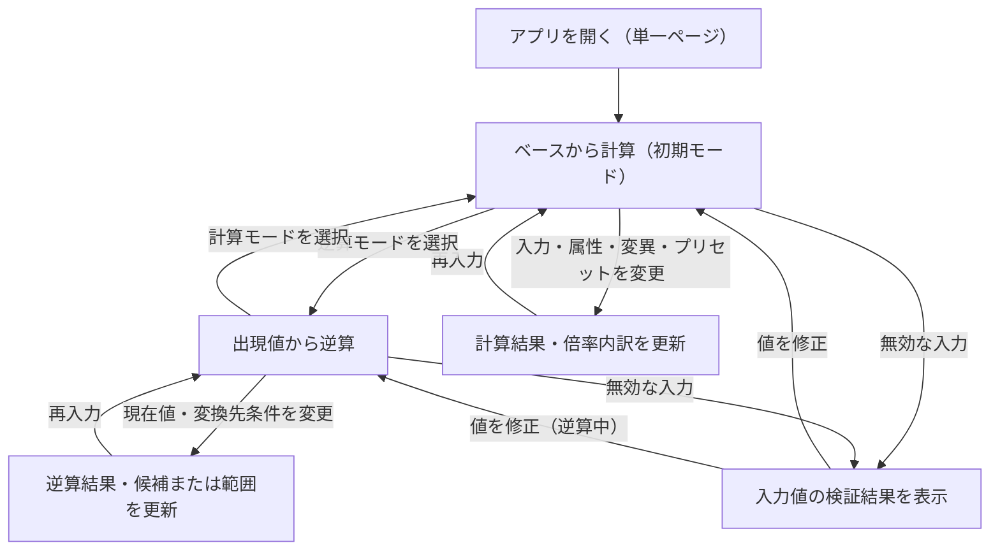

# 画面遷移図 — Fortnite Fight the BRAINROT Power Calculator

- 対象: `main` にある単一HTMLの静的Webアプリ
- 根拠: [`index.html`](../index.html) の `data-mode`、切替ボタン、入力・結果更新処理
- 表現: **独立したURL画面ではなく、同一ページ内の計算モード切替**

## 画面・状態の遷移

## 実装との対応

| 図の要素 | 実装上の対応 |
| --- | --- |
| ベースから計算 | `body[data-mode="forward"]` と `[data-panel="forward"]` |
| 出現値から逆算 | `body[data-mode="reverse"]` と `[data-panel="reverse"]` |
| 結果更新 | `updateForward()` / `updateReverse()` |
| 切替 | `setMode()` と `[data-mode-button]` |

本図は画面全体のページ遷移ではなく、単一ページ内の主要操作と表示状態を表します。将来の新規画面やルートは含めません。ブラウザ実機での操作確認は行っていません。
